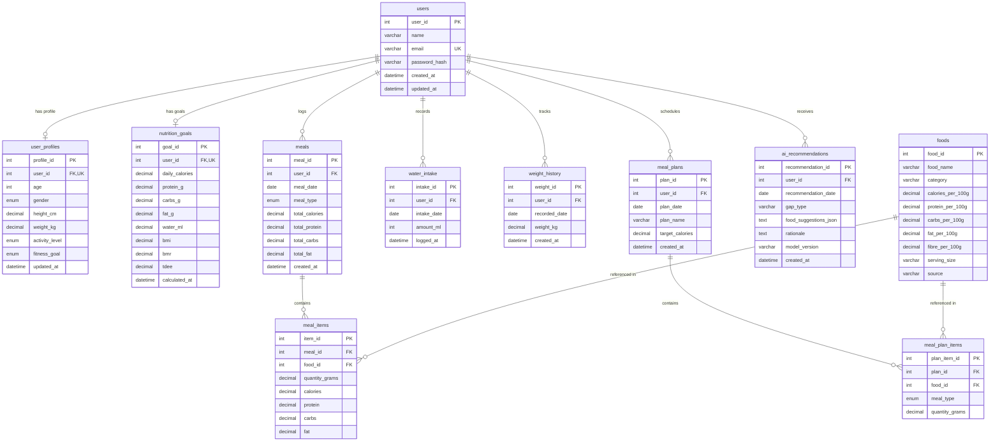

# Database Design & Entity Relationship Specifications

## 1. Database Specifications
- **Database Engine**: MySQL 8.0+
- **Collation**: `utf8mb4_unicode_ci`
- **Database Name**: `fitmaster_ai`

## 2. Entity-Relationship (ER) Diagram

## 3. Relational Normalization & Constraints
- **Primary Keys**: Every table uses an auto-increment integer or composite key.
- **Unique Constraints**: `users(email)`, `user_profiles(user_id)`, `nutrition_goals(user_id)`.
- **Foreign Keys**: Enforce referential integrity with cascading updates and deletes where appropriate (`ON DELETE CASCADE`).
- **Indexes**:
  - `idx_foods_search`: Index on `foods(food_name, category)`.
  - `idx_meals_user_date`: Composite index on `meals(user_id, meal_date)`.
  - `idx_water_user_date`: Composite index on `water_intake(user_id, intake_date)`.
  - `idx_weight_user_date`: Composite index on `weight_history(user_id, recorded_date)`.
